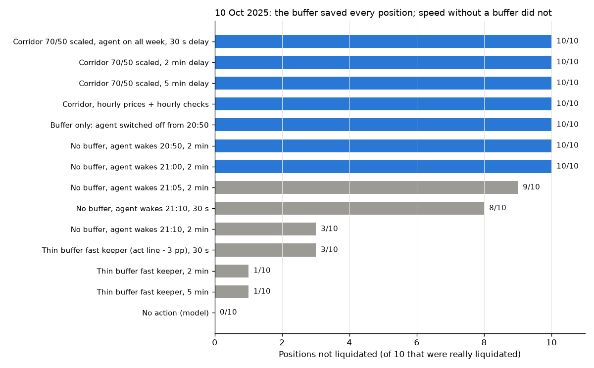

# Backtest: real liquidated borrowers vs. our policy on the same price paths

Research date: 22 Oct 2026. All times UTC. This is pre-hackathon analysis. The scripts are throwaway code in the session scratchpad (paths at the end), and nothing was written to `hackathon/` or to any repository. Only free public data was used: Binance public klines, the Morpho GraphQL API, and free public RPCs (drpc, publicnode, mevblocker, flashbots). No paid service or API key was used. Nothing needed a paid key in the end, though the free-tier limits forced two workarounds (see §7).

**Tags used below**
- **[ON-CHAIN]**: read from chain state or events this session.
- **[MODEL]**: simulator output.
- **[ASSUMPTION]**: a modelling choice I made. They are all listed in §6.
- **[EST]**: my arithmetic.

---

## 1. Answer first

**10 October 2025: which positions would our policy have saved, and was it the buffer or the speed?**

- **All 10 sampled positions that were really liquidated on 10 Oct would have survived under the corridor policy.** There are 6 on Aave V3 Ethereum: 0x3ee3 (wstETH), 0x4d43 (wstETH), 0x7f55, 0x4a89 and 0x8b40 (WETH), and 0xbF34 (WBTC, the "HF 1.04–1.10 for weeks" borrower). There are 4 on Morpho Base cbBTC/USDC: 0xb0e7, 0x959a, 0xe6c4 and 0xf8c0. **[MODEL]**
  - That holds at 30 s, 2 min and 5 min action delay.
  - It holds on minute data and on hourly data.
  - It holds with optimistic and with pessimistic fills.
  - Real penalties avoided: **$1.97M** in total. **[ON-CHAIN + MODEL]**
- **It was the buffer, not the speed.** Four pieces of evidence:
  - **Every sale that mattered happened on 7–8 October, 2–3½ days before the crash.** The four Morpho positions started at 76–83% LTV on 7 Oct, above the 70% act line, so the agent sold them to 50% at once. The Aave positions crossed their scaled act lines (66–68% of value) during the slow drift on 7–8 Oct.
  - **"Buffer only" also saves 10/10.** In this variant the agent is switched off from 20:50 on 10 Oct, so it does nothing during the crash.
    - Peak oracle LTV between 20:00 and 24:00 on 10 Oct was 56–65%, against lines of 78–86%. (Morpho 0x959a is not in that range: in the policy world its owner's own repays and withdrawals closed it before 21:00.)
    - The buffered agent did not need a single sale during the crash. Its crash-window path is identical with the agent switched off.
  - **Speed without a buffer fails.** A fast keeper whose act line sits 3 pp under the liquidation line (target 6 pp under) saves only **3/10 at a 30 s delay, 1/10 at 2 min and 1/10 at 5 min.** It is the same agent with the same slices, only without the buffer.
  - **A no-buffer agent that wakes up during the crash is saved only if it starts early.**
    - Waking at 20:50 or 21:00 with ≤ 2 min delay saves 10/10.
    - Waking at 21:05 saves 9/10.
    - Waking at 21:10 saves 3/10 at 2 min (8/10 at 30 s).
    - Waking at 21:13 saves 2/10.
    - Those "early" saves also sell at crash prices, with 26 reverted sales. Equity at the end of the window is about $0.45M above actual, against $10.6M for the buffered policy.
- **Why speed does not work on 10 Oct** (see [the oracle chart](backtest_charts/summary_oct10_oracle_vs_binance.png)):
  - Single Chainlink rounds moved LTV by 3–9 pp at once. Examples: 79.7% → 86.3% on Morpho at 21:24:31, and 79.9% → 83.5% on Aave at 21:17:47.
  - During the fall the oracle sat up to 4.7% *above* Binance (BTC at 21:19) and up to 5.3% *below* it at 21:21 (ETH).
  - With the executor's rule that a sale must fill within 1% of the oracle, protective sales in the final 10 minutes were withheld or reverted.
  - Liquidators acted 0–70 s after the crossing round.
  - Most of the damage happened between 21:13 and 21:25. You cannot out-run that; you can only not be standing there. This confirms the good_cases.md prior, now with a simulator.

**Headline numbers** (plain rule, scaled corridor, 2 min delay, no re-lever; "actual" is the real outcome)

| | Set A: Morpho cbBTC, 31 Jan – 6 Feb 2026 (10 positions) | Set B: 10–11 Oct 2025 (10 positions) |
|---|---|---|
| Saved from liquidation | **10 / 10** | **10 / 10** |
| Real penalties paid (protocol formula) | $681.7k | $1.97M |
| Penalties under the policy | $0 | $0 |
| Median extra collateral kept at end of window (% of start collateral) | +46.8% | +5.1% |
| Net equity vs actual, summed: at the bottom / end of window | +$2.58M / +$3.30M | +$12.22M / +$10.60M |
| Net equity today (22 Oct 2026), managed continuation, policy vs actual leftover held passively | $6.86M vs $2.89M | $12.90M vs $1.48M |
| Cost: slippage + gas | $21.4k + $2 | $437k + $572 |
| Who could not be saved | nobody under the corridor policy (any delay, minute or hourly) | nobody under the corridor policy; see §5 for the stress variants |

How to read the equity rows. Penalty avoided is the clean number. The equity difference also contains two other things:
- **Not being force-sold at the bottom.** This is real policy value.
- **Holding less leverage into a falling market.** This is partly direction luck; in a rally the de-levered position would have lagged.

The "hold, no loan" baseline (sell instead of borrow) beats every levered variant in both sets, because both windows were falls.

---

## 2. What was simulated

### 2.1 Cases (selection, start state, real outcome)
- **Set A.** Morpho Blue Base cbBTC/USDC (market `0x9103…1836`, LLTV 86%, LIF = 1/(0.3·0.86+0.7) = 1.0438). **[ON-CHAIN]**
  - From all 5,332 liquidations (5,070 borrowers) between 31 Jan and 6 Feb 2026, I took the **5 borrowers with the most debt repaid by liquidators** and **5 drawn at random**. The draw used Python `random.Random(20261022)`, made before any simulation.
  - The random draw includes two dust positions ($2 and $130 of debt at T0). I kept them as drawn.
  - Start T0 = 28 Jan 2026 00:00. The real state at T0 comes from the Morpho API hourly position history.
- **Set B.** 10–11 Oct 2025, start T0 = 7 Oct 2025 00:00.
  - **Aave V3 Ethereum:** from the 902 LiquidationCall events (623 borrowers), I took WETH- or wstETH-collateral, USDC/USDT-debt positions where that one collateral and one debt asset made up at least 85% of the position at T0 and E-mode was off. That gave 3 largest + 3 random. I added **0xbF34 (WBTC/USDT)** from good_cases.md.
  - Reserve parameters were read on-chain at 7 Oct:
    - WETH: liquidation threshold 83%, bonus 5%.
    - wstETH: 81%, 6%.
    - WBTC: 78%, 5%.
    - USDC/USDT variable APR: 5.36% / 5.40%.
  - The close factor is 50%, or 100% below HF 0.95 or under $2,000 of debt or collateral.
  - **Morpho Base cbBTC/USDC:** from 407 liquidations, the 2 largest + 2 random.
  - **0x031f72 is excluded from all aggregates.** 11% of its collateral is a second asset that evidently crashed harder than ETH, and a single-asset model cannot reproduce its real liquidation. Its chart and rows are kept.
- **Replay check.** Replaying each position's real owner transactions and real liquidations from T0 reproduces the venue's own hourly state:
  - Morpho: collateral exactly, debt within 0.4%.
  - Aave: within 0.04%, once aToken transfers were included (1inch limit-order sales of aTokens, WETH-gateway withdrawals).
- **Liquidation-timing check.** The no-action model (real Chainlink rounds + liquidation rule) liquidates:
  - Morpho: in the same second as reality in 8 of 14 cases, and 0–32 s earlier in 5 more. The 14th is the $2 dust position, which liquidators only touched 48 minutes after it became liquidatable.
  - Aave: in the same block for 0xbF34, and 72 s to 3 min 12 s before reality for the others. Real liquidators waited one or more rounds; the model is the earliest possible liquidation, which is conservative for the policies.
  This is the main evidence that the oracle model is right. **[ON-CHAIN + MODEL]**

Case list with T0 state, inactivity and first liquidation tx: §8.1. Every liquidation tx hash: appendix §8.7.

### 2.2 Prices and oracles
- **Market price.** Binance 1-minute klines for BTCUSDT and ETHUSDT, 3–15 Oct 2025 and 22 Jan – 10 Feb 2026, plus hourly and daily series to 22 Oct 2026.
  - wstETH = ETH × the stETH ratio. The ratio comes from `stETH.getPooledEthByShares(1e18)`, the same RATIO_PROVIDER Aave's wstETH adapter uses, read at daily blocks: 1.21562 → 1.21631.
- **Oracle: real Chainlink rounds, not modelled thresholds.** **[ON-CHAIN]**
  - **Morpho:** the market oracle `0x663B…39B9` is a MorphoChainlinkOracleV2 with one base feed, **Chainlink BTC/USD on Base** (proxy `0x64c9…848F`, aggregator `0x852a…6ca8`), and no quote feed (USDC = $1). I read 2,351 rounds (Oct) and 7,670 rounds (Feb).
    - Median gap between rounds: 180 s (Oct) and 90 s (Feb). Maximum gap: 1,248 s.
    - The largest single move was 2.50%, on 10 Oct.
  - **Aave:** I used the sources `AaveOracle.getSourceOfAsset` returned at the 10 Oct block:
    - WETH: ETH/USD `0x5424…215e`, 485 rounds. Median gap 888 s, maximum 3,684 s, largest move 3.05%.
    - wstETH: CAPO adapter = that ETH/USD × the stETH ratio. It was not capped at the time.
    - WBTC: adapter = BTC/USD `0xb41e…0a` (309 rounds) × WBTC/BTC. WBTC/BTC was read at daily blocks and stayed within 0.1% of 1.
  - The rounds were read through `getTimestamp/getAnswer` (or the proxy's `getRoundData` on Base). That is the same data as the AnswerUpdated events. Free RPC log limits made events impractical; see §7.
  - **No deviation-threshold model was needed.**
- On 10 Oct, **Binance wicked lower than the oracles**:
  - BTC: Binance $102,000 against a Base Chainlink low of $105,107.
  - ETH: Binance $3,435 against Aave's source low of $3,456.70.
  - Marking at the Binance minute low therefore overstates the "bottom" relative to what the venues saw.

### 2.3 Policies (the design's §3 corridor and §4.2 executor rules)
- **P2, plain rule.** It runs from T0, so it also keeps the buffer in calm times.
  - **Scaled corridor.** act = 70/86 × line, target = 50/86, floor = 30/86, ceiling = 60/86. For Morpho that is 70/50/30/60.
  - **Literal corridor.** 70/50/30/60 on Aave too.
  - **Protective session.** It starts when the executor sees LTV above the act line. Sales inside it are not budget-limited and are clamped so LTV after the sale is at or above target. The session ends at target or after 24 h.
  - **Discretionary sales.** Outside a session, sales need LTV above the floor and come out of a rolling 24 h budget of 20% of collateral.
  - **Sizing and timing.** Slice maximum 25% of current collateral. Decisions are made every minute and at every oracle round, with a 2 min cooldown between decisions. Pipelined orders are allowed.
  - **Delay.** Decision to landing takes 30 s, 2 min or 5 min.
  - **Executor ceiling.** Each fill must be within 1% of the oracle, or the sale reverts (and still pays gas).
- **P3, plain rule + exchange signal.** When the Binance close falls by X% or more from its rolling Y-minute high, the agent sells toward target LTV *at the Binance price*, inside the discretionary budget and above the floor.
  - Default X = 2%, Y = 15 min. I fixed it before seeing results; sensitivity is in §8.5.
- **Re-lever variant.** Buy back toward the 60% ceiling when LTV is below target, at least 24 h after the last sale, inside a 20%/day buy budget, and never on a stale feed (Base 1,200 s, Ethereum 3,600 s).
  - It only restores collateral the agent itself sold. That cap is my addition.
- **Stress and decomposition variants:**
  - Buffer only (agent off from the crash start).
  - No buffer: the agent starts at the crash, or wakes at 21:00, 21:05, 21:10 or 21:13.
  - Thin-buffer fast keeper (act = line − 3 pp, target = line − 6 pp).
  - Fills at the minute low.
  - Hourly prices with hourly decisions.
- **Owner flows.** Every real owner transaction after T0 (deposit, withdraw, borrow, repay, aToken transfer) is replayed in every policy world at its real time.
  - Withdrawals and borrows are clamped to what the venue would allow.
  - Repays the policy world did not need stay with the owner as cash.
  - Coins the owner really withdrew but could not withdraw in the policy world are subtracted at each valuation price.
  - So equity differences are not driven by owner cash flows.
- **Interest.**
  - Morpho: the market's borrow share-price growth over the window, as a continuous APR: 4.65% (Feb) and 7.26% (Oct).
  - Aave: the variable APR at T0.
  - Both are held constant. Utilisation spikes during the crashes are not modelled.

### 2.4 What "bottom", "end" and "today" mean
- **Bottom.** The minute of the Binance low in the crash window, marked at that minute's low:
  - Set A: 6 Feb 00:19, BTC $60,000.
  - Set B: 10 Oct 21:20, BTC $102,000 and ETH $3,435.
- **End of window.**
  - Set A: 8 Feb 00:00. That leaves about 1 day after the 24 h hold for re-levering.
  - Set B: 13 Oct 00:00.
- **Today** is 22 Oct 2026, 14:00 UTC hourly close: BTC $81,842, ETH $2,409.19. Two versions:
  1. **Static mark.** End-of-window holdings × today's price − debt grown at the window rate. For Set B this is mostly unrealistic: ETH fell 37% since October, so most static levered positions (actual and policy alike) would sit above their liquidation line today. Those rows are flagged.
  2. **Managed continuation (§8.6).** The simulation runs on from the end of the window to today on Binance *hourly* closes. The hourly close stands in for the oracle **[ASSUMPTION]**, because Chainlink rounds were only pulled for the crash windows. The policy keeps running. The real end-of-window leftover is held passively under the same liquidation model. That passive leftover is hypothetical: the real borrowers' later actions are unknown.
- **"Hold, no loan" baseline.** The coins the owner would hold if they had *sold* collateral for the cash they borrowed (at T0 and at each later borrow or repay) instead of borrowing it.

---

## 3. Set A: Morpho Base cbBTC/USDC, 31 Jan – 6 Feb 2026

- **The plain rule saves 10/10** at every delay, on minute and on hourly data. It avoids all **$681.7k** of real penalties.
- **Four positions were already above 70% at T0**: 0xec3d at 80.3%, 0x3e3d at 75.7%, 0x06ca at 73.3% and 0x2442 at 71.5%. The agent sold them to 50% within 3 minutes of T0, on 28 Jan, with BTC at about $89k. The others crossed 70% between 29 and 31 Jan and were sold then.
- **The sales happened days before the real liquidations.**
  - The two whales first liquidated on 31 Jan (0xec3d at 17:10, 0x3e3d at 18:44) were sold 3½ days before.
  - The positions first liquidated on 5 Feb were sold 5–8 days before.
- **After that, the policy only had to top up the buffer.** Real owners kept borrowing and adding collateral in the policy world too. For example, 0x3e3d made 208 own transactions after T0.
- **Extra collateral kept.** At the end of the window the median position kept **+46.8% of its starting collateral** more than in reality. Example: 0xec3d ends with 30.25 cbBTC instead of 3.65.
- **Equity.** Net equity at the end is +$3.30M above actual in total.
- **A thin-buffer fast keeper also saves 10/10 in this slow, stepped slide**, but with far less equity: +$0.82M against +$3.30M, because it sells lower. **In February speed works; the buffer only makes it cheaper.**
- **Re-lever costs money here.** Re-buying 24 h after a dip leaves the position re-exposed to the next leg down. Example: 0xec3d re-bought on 29 Jan and had to sell again on 5 Feb. Equity at the end is +$2.83M instead of +$3.30M.
- **The exchange signal adds about +$0.19M at the end**, but is not needed for survival.

Example charts:
- [0xec3d](backtest_charts/A-morpho-0xec3d8a.png): the largest, 80% LTV at T0.
- [0x4d49](backtest_charts/A-morpho-0x4d4916.png): a random sleeper, 252 days inactive.

## 4. Set B: 10–11 October 2025

See §1 for the answer.

**Position by position** (plain rule, 2 min). These are not "saved by speed" stories:
- **0xbF34 (WBTC, 22.7M USDT, 67.6% LTV at T0 vs. its 63.5% act line).**
  - The agent sold to about 45% on 7 Oct.
  - Peak LTV on 10 Oct was 55.8%.
  - Real outcome: one liquidation at 21:14:11, triggered by a single oracle round, costing a $562k penalty.
  - Under the thin-buffer keeper it is the only one saved at every delay, because BTC fell less than ETH.
- **0x3ee3 (wstETH, $44.6M USDC).**
  - It crossed its 65.9% act line on 7 Oct; the first sale landed at 15:40. Over the window the agent sold about $24.9M of wstETH, paying **$229k in modelled slippage (0.9%)**.
  - 0x4d43's first sale, on 7 Oct at 10:07, was triggered by the owner's own $5M borrow at 10:04.
  - Real outcome: 16 liquidations at 21:18–21:25 for $9.23M repaid and a $554k penalty. The owner then sold another 3,100 wstETH of aTokens via 1inch on 12 Oct.
  - The position is large enough that my size-based slippage model hits the cap. A real Base or Ethereum DEX route for $25M of wstETH in one day is the least certain part of this backtest.
- **Morpho 0x959a (83.3% LTV at T0, owner very active).**
  - The agent sold it to 50% on 7 Oct.
  - The owner's real repays and withdrawals, replayed in the policy world, then closed the position before the crash.
  - Its survival and equity are therefore partly the owner's doing. It is also the case where the withdrawal-shortfall accounting matters most.

**Hourly vs. minute data.** For the buffered policy, hourly data gives the same survival result in both sets: 10/10 and 10/10. Minute data, plus the real oracle rounds, **matters only for the speed questions**: thin buffer, late wake-up and the signal. There the outcome is decided inside 21:10–21:25, at the resolution of single oracle rounds.

**Pessimistic fills.** Filling every sale at the minute low instead of OHLC4 changes nothing about survival. The cost is 7 extra reverts.

**Exchange signal on 10 Oct** (2% from the 15-minute high, 2 min delay):
- Survival: 10/10, the same as without it. It adds nothing to survival.
- It sells into the wick, so equity is higher at the bottom (+$1.92M vs the plain rule) but lower at the end of the window (−$0.60M), once prices bounced.
- 16 of its sales reverted on the 1% ceiling, because the oracle lagged the falling exchange price.
- Every one of the 12 sensitivity settings (§8.5) ends below the plain rule in Set B. In Set A the effect is −$0.17M to +$0.33M.
- Conclusion: a price-drop trigger on an exchange is not the agent's edge in a flash crash. If it has value, it is in slow slides, and the evidence for that is weak.

**Re-lever reduces the buffer before the next leg.**
- On 8 Oct, 24 h after its sales, the re-lever variant bought back toward the 60%-of-value ceiling. It therefore entered 10 Oct closer to the line. Example: [0x3ee3](backtest_charts/B-aave-0x3ee301.png) sat at about 63% and peaked near 70% in the wick against an 81% line, and had to sell into the crash.
- It still survived in every case, but equity at the end of the window is $7.89M above actual, against $10.60M for the plain rule.
- In the managed continuation to today it churns: 89–344 sales and 6–15 re-buys per Aave position over the year.

## 5. Who could not be saved, and why

- **Under the corridor policy: no one, in either set.** That covers scaled or literal corridors, 30 s to 5 min delay, minute or hourly data, OHLC4 or low fills, and with or without re-lever or signal.
- **Under the stress variants**, the classifier (§8.4) gives three recurring reasons:
  1. **Oracle jump.** One Chainlink round moved LTV from below the act line, or from just under the liquidation line, to above it. Examples: 0x959a 79.7% → 86.3% (21:24:31), 0x7f55 and 0x4a89 79.9% → 83.5% (21:17:47), 0xf8c0 77.2% → 86.0% (11 Oct 01:38). No delay helps here; only distance helps.
  2. **Sale in flight.** The agent had decided, but the transaction landed after the liquidating round. This is the "gap faster than the delay" case. It dominates at 2–5 min delay.
  3. **Oracle–market gap above the 1% executor ceiling.** At 21:13–21:25 the oracle was up to 4.7% above Binance for BTC and up to 4.5% above for ETH (21:19). A sale bounded at oracle − 1% either reverted or the agent withheld it. This is an honest cost of the executor's safety rule. With the buffer it never binds, because no sale is needed at that moment.
- **Set A, speed-only (agent on from 5 Feb 12:00):** 2/10 were lost. Both were liquidated on 31 Jan, before the agent was switched on, so this is a definition artefact and not a speed failure. The thin keeper is the fair speed test for Set A, and it saves 10/10.

## 6. Assumptions, estimates and simplifications (all labelled [ASSUMPTION] unless noted)

| # | Item | What I did | Direction of bias |
|---|---|---|---|
| 1 | Execution price | Binance 1-minute OHLC4 of the minute the transaction lands; USDT treated as USD | Unknown. On 10 Oct Binance wicked below the oracles, which pessimises crash-minute fills. Sensitivity: fills at the minute low change no survival result |
| 2 | Slippage | 0.05% below $100k, then 0.05% + 0.1% per $1M in the slice, capped at 1%. The agent sizes slices so that slippage + oracle gap ≤ 0.9% | Probably optimistic for $10M+ wstETH or WBTC slices on 7–8 Oct (0x3ee3, 0x4d43, 0xbF34); DEX depth is not modelled |
| 3 | Executor ceiling | A sale must fill ≥ oracle × 0.99, a buy ≤ oracle × 1.01, else it reverts and still pays gas | As designed |
| 4 | Aave executor | The design's executor is Morpho-only; for Aave I assume an equivalent executor reading Aave's oracle | Hypothetical |
| 5 | Oracle | Real Chainlink rounds; within the same timestamp, the last round wins. WBTC/BTC and the stETH ratio come from daily samples (they moved by under 0.1%) | Model liquidates 0–70 s *before* real liquidators, which is conservative for policies |
| 6 | Liquidator model, for failed policies and the no-action check | Morpho: full close at the first crossing round. Aave: 50% close factor (100% below HF 0.95 or under $2k), repeated while HF < 1 | Upper-bounds penalties for failures. Real Morpho whales were liquidated in 5–8 partial bites |
| 7 | Real penalty | repaid × bonus (Aave) or repaid × (LIF − 1) (Morpho). On Aave the protocol-fee share of the bonus is also lost by the borrower and is included in the seized collateral | [EST], exact up to rounding |
| 8 | Interest | Constant over the window: Morpho share-price APR (4.65% Feb, 7.26% Oct), Aave variable APR at T0 (about 5.4%) | Small; crash-time rate spikes are ignored |
| 9 | Gas | Base $0.03 and Ethereum $5 per agent transaction, including reverts. Discretionary orders must be worth at least 20× gas | Ethereum gas spiked on 10 Oct; not modelled |
| 10 | Owner behaviour | Real owner transactions are replayed in every world, with clamps and cash or coin adjustments. Reality: some top-ups were reactions to stress that a managed owner might not have made | Neutral by construction for flows that fit; flagged where clamped |
| 11 | Agent latency | The delay covers everything from decision to landing (NEAR, Chain Signatures, relayer, inclusion). There is no outage modelling (§4.7 of the design: if NEAR, the signer or the relayer is down, the position waits) | Optimistic on availability |
| 12 | Start time | T0 = 28 Jan (A) and 7 Oct (B), 3 days before the first big leg. The agent acts at T0 if LTV is above the act line | Positions that sat high long before T0 would have been de-risked earlier; neutral for survival |
| 13 | wstETH market | wstETH is valued at ETH × the stETH ratio. Any wstETH/ETH DEX discount during the crash is not modelled | Optimistic for wstETH sales on 10 Oct; irrelevant for the buffered policy, which sold on 7–8 Oct |
| 14 | "Today" | Static mark plus the managed hourly continuation, with a proxy oracle | Continuation is approximate; static Set B marks are mostly unrealistic (flagged) |
| 15 | Sample | 20 positions in the aggregates (10 + 10). Random draws are seeded; two are dust | Small-sample: survival rates are not population estimates |
| 16 | Equity vs actual | Contains penalty, forced-sale and leverage-direction effects | Overstates "policy skill" in falling markets |

## 7. Data provenance and workarounds (free sources only)
- **Morpho.** `api.morpho.org/graphql`: `marketTransactions` gave every liquidation and each case's own transactions; `marketPosition.historicalState` gave hourly collateral, borrowAssets and borrowShares.
- **Aave V3 Ethereum.**
  - LiquidationCall and Supply/Withdraw/Borrow/Repay events, plus collateral aToken Transfer events, via `rpc.mevblocker.io` and `rpc.flashbots.net` logs.
  - Account data, balances, reserve configuration and oracle prices at historical blocks via `eth.drpc.org` archive `eth_call`, wrapped in Multicall3. The free tier allows only 3 requests per JSON-RPC batch.
- **Chainlink.** Base aggregators have read access control and drpc's free tier caps Base `eth_getLogs` at about 100 blocks. So I read rounds through the **proxy's `getRoundData` (phase 1)** via Multicall3. Ethereum aggregators were read directly.
- **Binance.** `api.binance.com/api/v3/klines`, 1m, 1h and 1d.
- **Not used.** No paid service and no agentcash. Nothing was skipped for lack of a paid key.

## 8. Generated tables
(Produced by `scripts/tables.py` from the result files. Rows for 0x031f72 are shown but excluded from totals.)

### 8.1 Cases

#### Set A: Morpho Base cbBTC/USDC, 31 Jan - 6 Feb 2026

| Case | Borrower | Venue / collateral | How picked | Start state (T0) | LTV at T0 (oracle) | Liquidation line | Days since own last action before 1st liquidation | Real liquidations in window | First liquidation tx |
|---|---|---|---|---|---|---|---|---|---|
| A-morpho-0xec3d8a | [0xec3d...c9ae](https://basescan.org/address/0xec3d8aa433086abaaaefbc0fb0b138c84010c9ae) | Morpho Base cbBTC/USDC, cbBTC | largest | 66.75 cbBTC / $4.78M debt | 80.3% | 86% | 1.5 | 8, $4.75M repaid, first 31 Jan 17:10:29 | [0x7313bf4a...](https://basescan.org/tx/0x7313bf4a1122c93eb712bdd6f759af9ab6b4080a962a6821c0708b1216a89f1f) |
| A-morpho-0xff367c | [0xff36...7d96](https://basescan.org/address/0xff367c5b2e9b0dbbc390f6eae34ca7458daf7d96) | Morpho Base cbBTC/USDC, cbBTC | largest | 86.00 cbBTC / $5.04M debt | 65.8% | 86% | 1.9 | 8, $3.15M repaid, first 05 Feb 17:22:05 | [0x7675fe6b...](https://basescan.org/tx/0x7675fe6b644ac397132bf658a798c0b8dfe4c64f666917ab36fa131e3f60b3f4) |
| A-morpho-0x94cdda | [0x94cd...d146](https://basescan.org/address/0x94cdda5755cc5df9e3d14df6ff819ab082b2d146) | Morpho Base cbBTC/USDC, cbBTC | largest | 65.19 cbBTC / $3.90M debt | 67.2% | 86% | 4.3 | 5, $2.75M repaid, first 05 Feb 12:16:09 | [0x7ddfeb19...](https://basescan.org/tx/0x7ddfeb196a563e4ea5e1d6cb95b41423ed4de99cbac66b0b18b20d1b5b38b4b4) |
| A-morpho-0x3e3d7d | [0x3e3d...b836](https://basescan.org/address/0x3e3d7daf2f97e06c11048c91fe21962880d2b836) | Morpho Base cbBTC/USDC, cbBTC | largest | 40.07 cbBTC / $2.70M debt | 75.7% | 86% | 0.1 | 5, $2.63M repaid, first 31 Jan 18:44:27 | [0x5d250d22...](https://basescan.org/tx/0x5d250d22482fee6c412cf6b5c852fde3ab670cbeadc5706e17b89ef34547e23e) |
| A-morpho-0x06cab7 | [0x06ca...ca71](https://basescan.org/address/0x06cab7c8ecdb5bc6e974e0ea838e4175ada7ca71) | Morpho Base cbBTC/USDC, cbBTC | largest | 44.30 cbBTC / $2.89M debt | 73.3% | 86% | 0.2 | 5, $2.16M repaid, first 05 Feb 19:58:53 | [0xa690e2cc...](https://basescan.org/tx/0xa690e2ccd7042d3a5b048f538d444ed906fbb36c3bcb92eafba2083efd0702d3) |
| A-morpho-0x4d4916 | [0x4d49...1620](https://basescan.org/address/0x4d491684455e06c7e67e0bc929f9177527121620) | Morpho Base cbBTC/USDC, cbBTC | random | 0.0091 cbBTC / $501 debt | 61.5% | 86% | 251.8 | 1, $502 repaid, first 05 Feb 20:22:55 | [0xc888d3cb...](https://basescan.org/tx/0xc888d3cb55aa30c1a75212d27b8f446372791c5090a8a2204481346561f39abe) |
| A-morpho-0xd5977a | [0xd597...e835](https://basescan.org/address/0xd5977a5fc338922946eeae5520a59be074f2e835) | Morpho Base cbBTC/USDC, cbBTC | random | 0.0000 cbBTC / $2.03 debt | 64.9% | 86% | 102.1 | 1, $2.03 repaid, first 05 Feb 16:11:13 | [0xb88fcf43...](https://basescan.org/tx/0xb88fcf432bf4fa7d40fea6db4ee8d53b82ca03ea204e7a1fd1a162a03d333be9) |
| A-morpho-0x3d62b2 | [0x3d62...fd18](https://basescan.org/address/0x3d62b2e8f6cd484bc816ef476617d25d3c44fd18) | Morpho Base cbBTC/USDC, cbBTC | random | 0.0024 cbBTC / $130 debt | 61.1% | 86% | 1.9 | 1, $2.0k repaid, first 05 Feb 15:23:11 | [0xd08cbbd4...](https://basescan.org/tx/0xd08cbbd49c40cf9150c23db37cdb5d59ea3278e26e6a34d63e892dd5ca692b05) |
| A-morpho-0x4d985b | [0x4d98...de6f](https://basescan.org/address/0x4d985bf3236ddd4c2af8d062de547d184818de6f) | Morpho Base cbBTC/USDC, cbBTC | random | 0.1916 cbBTC / $11.5k debt | 67.6% | 86% | 7.1 | 1, $11.5k repaid, first 05 Feb 20:25:55 | [0x4fa13bc3...](https://basescan.org/tx/0x4fa13bc3db9d1a73b9d6c0f98f9ad6f5f32c2cd0a8ab7ec595ce6cbeb8e304d8) |
| A-morpho-0x2442f0 | [0x2442...4ffd](https://basescan.org/address/0x2442f00ea1ad4464840434699e44625cb8624ffd) | Morpho Base cbBTC/USDC, cbBTC | random | 1.6034 cbBTC / $102.2k debt | 71.5% | 86% | 0.8 | 1, $97.2k repaid, first 05 Feb 12:20:05 | [0x83af3a02...](https://basescan.org/tx/0x83af3a022fc2216c668825595dc1b2dc6d260d142372ca566ce6240e5cc61212) |

#### Set B: 10-11 Oct 2025

| Case | Borrower | Venue / collateral | How picked | Start state (T0) | LTV at T0 (oracle) | Liquidation line | Days since own last action before 1st liquidation | Real liquidations in window | First liquidation tx |
|---|---|---|---|---|---|---|---|---|---|
| B-morpho-0xb0e72d | [0xb0e7...db53](https://basescan.org/address/0xb0e72d306b3a2463b009bea150471bb0124bdb53) | Morpho Base cbBTC/USDC, cbBTC | largest | 9.2928 cbBTC / $894.5k debt | 77.1% | 86% | 5.6 | 1, $895.2k repaid, first 10 Oct 21:13:29 | [0xb80f01c9...](https://basescan.org/tx/0xb80f01c9737e7e821c4cf293f55e624cc90adbad85e8999bf5aa44583eceaf35) |
| B-morpho-0x959ace | [0x959a...49aa](https://basescan.org/address/0x959ace5e01d19d11c074a75de62fa36048db49aa) | Morpho Base cbBTC/USDC, cbBTC | largest | 13.01 cbBTC / $1.35M debt | 83.3% | 86% | 0.0 | 2, $819.0k repaid, first 10 Oct 21:13:33 | [0x0335796f...](https://basescan.org/tx/0x0335796fc831e5230326f733d25154b16fdf938f26e75181c814209edf13f1ad) |
| B-morpho-0xe6c4b2 | [0xe6c4...bbbb](https://basescan.org/address/0xe6c4b2c479de0bdd9727d1d3308cd9fdf1efbbbb) | Morpho Base cbBTC/USDC, cbBTC | random | 0.0018 cbBTC / $171 debt | 76.0% | 86% | 5.5 | 1, $171 repaid, first 10 Oct 21:17:37 | [0xc277ff1d...](https://basescan.org/tx/0xc277ff1d29013cb67ac3cc3f338c361c95fac33572c869512f58a13750a3997b) |
| B-morpho-0xf8c017 | [0xf8c0...39e8](https://basescan.org/address/0xf8c0176e8bbd1e68b358ff253c104260556939e8) | Morpho Base cbBTC/USDC, cbBTC | random | 0.1002 cbBTC / $9.5k debt | 75.6% | 86% | 4.2 | 1, $9.5k repaid, first 10 Oct 21:18:01 | [0x6ce0699c...](https://basescan.org/tx/0x6ce0699c9053281451e7eac279a7b87c81255d70ed63e1c96763fa4d7d25e0dd) |
| B-aave-0x3ee301 | [0x3ee3...42a6](https://etherscan.io/address/0x3ee301d27fd556eca7aaa8c50cdbd461577c42a6) | Aave V3 Ethereum, wstETH | largest | 12,290.31 wstETH / $44.59M debt | 63.6% | 81% | >30 (no own action in the 30 d scanned) | 16, $9.23M repaid, first 10 Oct 21:18:59 | [0xd2baa3bc...](https://etherscan.io/tx/0xd2baa3bcea74f0353d80e3dfce1a07b3ebe9fb7baf28f2ede7636786e785b7b8) |
| B-aave-0x4d43aa | [0x4d43...64e9](https://etherscan.io/address/0x4d43aadee75419a4535400dee43690b5fe8c64e9) | Aave V3 Ethereum, wstETH | largest | 8,078.53 wstETH / $26.09M debt | 56.6% | 81% | 3.5 | 5, $11.37M repaid, first 10 Oct 21:24:11 | [0x717cc526...](https://etherscan.io/tx/0x717cc52695bd5b19e485750308f61cbbf693b26dff9e90f0323876814d35d79a) |
| B-aave-0x7f55a0 | [0x7f55...40d1](https://etherscan.io/address/0x7f55a0b28ba031dc08c1fdf7336a74e399b840d1) | Aave V3 Ethereum, WETH | largest | 970.22 WETH / $2.90M debt | 63.7% | 83% | 5.7 | 2, $1.71M repaid, first 10 Oct 21:18:59 | [0xc9658c5f...](https://etherscan.io/tx/0xc9658c5f6530fbd3119d9ff099f02d1c265d945ad974f96f81b48701dbbb1729) |
| B-aave-0x4a89c6 | [0x4a89...72db](https://etherscan.io/address/0x4a89c6fb06da5dfa0e57b38344371ab2c38972db) | Aave V3 Ethereum, WETH | random | 13.20 WETH / $41.1k debt | 66.3% | 83% | 5.9 | 1, $20.5k repaid, first 10 Oct 21:16:23 | [0xe6450545...](https://etherscan.io/tx/0xe64505453454517f21cc132b29189de2a0898b188d06eb9fd46df8f0d6601a95) |
| B-aave-0x8b40ea | [0x8b40...92e9](https://etherscan.io/address/0x8b40ea62e079b4fc5385e10c64037d70199092e9) | Aave V3 Ethereum, WETH | random | 163.97 WETH / $482.1k debt | 62.7% | 83% | 2.7 | 1, $253.4k repaid, first 10 Oct 21:19:23 | [0x8f4f2866...](https://etherscan.io/tx/0x8f4f286605a2d6dcff3f4ebae65d5dd3bf9b6c2be780445902fd690755985593) |
| B-aave-0x031f72 (excluded from aggregates) | [0x031f...b220](https://etherscan.io/address/0x031f72deb03c509af42624ddcd1f63fce5ecb220) | Aave V3 Ethereum, WETH | random | 90.51 WETH / $288.3k debt | 67.9% | 83% | 0.1 | 1, $139.2k repaid, first 10 Oct 21:18:59 | [0xee79940c...](https://etherscan.io/tx/0xee79940c5cd086d3b7ed83f5386ee3cad64510420041293c1495fd3e52d04432) |
| B-aave-0xbf3401 | [0xbf34...bee8](https://etherscan.io/address/0xbf3401cee68f45d1963407076c119f1b3867bee8) | Aave V3 Ethereum, WBTC | good_cases (HF 1.04-1.10 for weeks) | 268.39 WBTC / $22.68M debt | 67.6% | 78% | 0.1 | 1, $11.24M repaid, first 10 Oct 21:14:11 | [0xefe08cc9...](https://etherscan.io/tx/0xefe08cc929867c64635863c0f38116c03e9ea23227ed09af6b9e5b9be578cd8f) |

### 8.2 Per-position results (main policies)

All policies here use the scaled corridor and a 2 min delay. "Hold, no loan" is the sell-instead-of-borrow baseline. The static "today" mark is explained in §2.4; see §8.6 for the managed continuation.

#### Per-position results, Set A

| Case | Policy | Liquidated | Penalty paid | Collateral at end | Debt at end | Net equity at bottom | Net equity at end of window | Net equity today (22 Oct 2026, static mark) | Static LTV today |
|---|---|---|---|---|---|---|---|---|---|
| A-morpho-0xec3d8a | Actual | yes (8) | $208.5k | 3.6547 | $75.6k | $143.7k | $177.4k | $221.0k | 26% |
| A-morpho-0xec3d8a | Plain rule, 2 min | no | $0.00 | 30.25 | $1.22M | $594.3k | $873.0k | $1.21M | 51% |
| A-morpho-0xec3d8a | Rule + signal 2%/15 min | no | $0.00 | 23.95 | $782.4k | $654.9k | $875.7k | $1.15M | 41% |
| A-morpho-0xec3d8a | Rule + re-lever | no | $0.00 | 25.05 | $984.6k | $554.4k | $749.3k | $1.03M | 50% |
| A-morpho-0xec3d8a | Hold, no loan | - | - | 16.68 | - | $1.00M | $1.15M | $1.37M | - |
| A-morpho-0xff367c | Actual | yes (8) | $138.2k | 44.38 | $2.03M | $328.2k | $1.04M | $1.54M | 58% |
| A-morpho-0xff367c | Plain rule, 2 min | no | $0.00 | 61.13 | $2.29M | $1.07M | $1.94M | $2.63M | 47% |
| A-morpho-0xff367c | Rule + signal 2%/15 min | no | $0.00 | 48.63 | $1.42M | $1.19M | $1.95M | $2.52M | 37% |
| A-morpho-0xff367c | Rule + re-lever | no | $0.00 | 54.86 | $2.06M | $1.01M | $1.74M | $2.37M | 47% |
| A-morpho-0xff367c | Hold, no loan | - | - | 37.16 | - | $2.23M | $2.57M | $3.04M | - |
| A-morpho-0x94cdda | Actual | yes (5) | $120.4k | 24.08 | $1.16M | $190.3k | $504.7k | $769.9k | 61% |
| A-morpho-0x94cdda | Plain rule, 2 min | no | $0.00 | 24.43 | $692.6k | $680.8k | $998.7k | $1.28M | 36% |
| A-morpho-0x94cdda | Rule + signal 2%/15 min | no | $0.00 | 30.52 | $946.4k | $792.7k | $1.17M | $1.52M | 39% |
| A-morpho-0x94cdda | Rule + re-lever | no | $0.00 | 29.01 | $1.02M | $680.8k | $993.2k | $1.33M | 44% |
| A-morpho-0x94cdda | Hold, no loan | - | - | 23.00 | - | $1.38M | $1.59M | $1.88M | - |
| A-morpho-0x3e3d7d | Actual | yes (5) | $115.2k | 3.0547 | $133.4k | $57.6k | $78.0k | $112.2k | 55% |
| A-morpho-0x3e3d7d | Plain rule, 2 min | no | $0.00 | 21.27 | $927.9k | $356.4k | $544.6k | $782.2k | 55% |
| A-morpho-0x3e3d7d | Rule + signal 2%/15 min | no | $0.00 | 15.69 | $527.3k | $418.1k | $559.1k | $739.6k | 42% |
| A-morpho-0x3e3d7d | Rule + re-lever | no | $0.00 | 21.27 | $927.9k | $356.4k | $544.6k | $782.2k | 55% |
| A-morpho-0x3e3d7d | Hold, no loan | - | - | 10.56 | - | $633.6k | $731.1k | $864.3k | - |
| A-morpho-0x06cab7 | Actual | yes (5) | $94.6k | 28.75 | $1.45M | $270.5k | $535.3k | $849.7k | 64% |
| A-morpho-0x06cab7 | Plain rule, 2 min | no | $0.00 | 43.83 | $1.77M | $861.4k | $1.27M | $1.76M | 51% |
| A-morpho-0x06cab7 | Rule + signal 2%/15 min | no | $0.00 | 35.31 | $1.18M | $936.0k | $1.26M | $1.67M | 42% |
| A-morpho-0x06cab7 | Rule + re-lever | no | $0.00 | 34.34 | $1.26M | $800.7k | $1.12M | $1.51M | 46% |
| A-morpho-0x06cab7 | Hold, no loan | - | - | 23.51 | - | $1.41M | $1.63M | $1.92M | - |
| A-morpho-0x4d4916 | Actual | yes (1) | $22 | 0.0009 | $0.00 | $55 | $63 | $74 | 0% |
| A-morpho-0x4d4916 | Plain rule, 2 min | no | $0.00 | 0.0055 | $215 | $114 | $165 | $227 | 49% |
| A-morpho-0x4d4916 | Rule + signal 2%/15 min | no | $0.00 | 0.0047 | $158 | $125 | $168 | $223 | 42% |
| A-morpho-0x4d4916 | Rule + re-lever | no | $0.00 | 0.0046 | $179 | $108 | $143 | $195 | 48% |
| A-morpho-0x4d4916 | Hold, no loan | - | - | 0.0035 | - | $212 | $244 | $289 | - |
| A-morpho-0xd5977a | Actual | yes (1) | $0.09 | 0.0000 | $0.00 | $0.21 | $0.25 | $0.29 | 0% |
| A-morpho-0xd5977a | Plain rule, 2 min | no | $0.00 | 0.0000 | $0.84 | $0.31 | $0.50 | $0.73 | 51% |
| A-morpho-0xd5977a | Rule + signal 2%/15 min | no | $0.00 | 0.0000 | $0.84 | $0.31 | $0.50 | $0.73 | 51% |
| A-morpho-0xd5977a | Rule + re-lever | no | $0.00 | 0.0000 | $0.84 | $0.31 | $0.50 | $0.73 | 51% |
| A-morpho-0xd5977a | Hold, no loan | - | - | 0.0000 | - | $0.74 | $0.86 | $1.02 | - |
| A-morpho-0x3d62b2 | Actual | yes (1) | $89 | 0.0035 | $0.00 | $212 | $245 | $289 | 0% |
| A-morpho-0x3d62b2 | Plain rule, 2 min | no | $0.00 | 0.0163 | $611 | $365 | $515 | $700 | 47% |
| A-morpho-0x3d62b2 | Rule + signal 2%/15 min | no | $0.00 | 0.0138 | $430 | $396 | $523 | $683 | 39% |
| A-morpho-0x3d62b2 | Rule + re-lever | no | $0.00 | 0.0163 | $611 | $365 | $515 | $700 | 47% |
| A-morpho-0x3d62b2 | Hold, no loan | - | - | 0.0088 | - | $526 | $607 | $718 | - |
| A-morpho-0x4d985b | Actual | yes (1) | $506 | 0.0208 | $0.00 | $1.2k | $1.4k | $1.7k | 0% |
| A-morpho-0x4d985b | Plain rule, 2 min | no | $0.00 | 0.1333 | $4.9k | $3.1k | $4.4k | $5.9k | 46% |
| A-morpho-0x4d985b | Rule + signal 2%/15 min | no | $0.00 | 0.1094 | $3.3k | $3.3k | $4.3k | $5.6k | 38% |
| A-morpho-0x4d985b | Rule + re-lever | no | $0.00 | 0.1279 | $5.0k | $2.6k | $3.8k | $5.3k | 50% |
| A-morpho-0x4d985b | Hold, no loan | - | - | 0.0820 | - | $4.9k | $5.7k | $6.7k | - |
| A-morpho-0x2442f0 | Actual | yes (1) | $4.3k | 0.2519 | $5.1k | $10.0k | $12.3k | $15.3k | 26% |
| A-morpho-0x2442f0 | Plain rule, 2 min | no | $0.00 | 1.0246 | $40.8k | $20.7k | $30.2k | $41.7k | 50% |
| A-morpho-0x2442f0 | Rule + signal 2%/15 min | no | $0.00 | 0.7884 | $23.7k | $23.6k | $30.9k | $40.0k | 38% |
| A-morpho-0x2442f0 | Rule + re-lever | no | $0.00 | 1.0246 | $40.8k | $20.7k | $30.2k | $41.7k | 50% |
| A-morpho-0x2442f0 | Hold, no loan | - | - | 0.5693 | - | $34.2k | $39.4k | $46.6k | - |

#### Per-position results, Set B

| Case | Policy | Liquidated | Penalty paid | Collateral at end | Debt at end | Net equity at bottom | Net equity at end of window | Net equity today (22 Oct 2026, static mark) | Static LTV today |
|---|---|---|---|---|---|---|---|---|---|
| B-morpho-0xb0e72d | Actual | yes (1) | $39.2k | 0.9399 | $0.01 | $95.9k | $108.0k | $76.9k | 0% |
| B-morpho-0xb0e72d | Plain rule, 2 min | no | $0.00 | 4.2367 | $264.5k | $167.7k | $222.2k | $61.7k | 82% |
| B-morpho-0xb0e72d | Rule + signal 2%/15 min | no | $0.00 | 3.6259 | $195.9k | $173.3k | $220.6k | $85.6k | 71% |
| B-morpho-0xb0e72d | Rule + re-lever | no | $0.00 | 4.2367 | $264.5k | $167.7k | $222.2k | $61.7k | 82% |
| B-morpho-0xb0e72d | Hold, no loan | - | - | 2.1181 | - | $216.0k | $243.3k | $173.4k | - |
| B-morpho-0x959ace | Actual | yes (2) | $35.9k | 0.0000 | $0.00 | $86.2k | $0.01 | $0.01 | 0% |
| B-morpho-0x959ace | Plain rule, 2 min | no | $0.00 | 0.0000 | $0.00 | $246.6k | $147.2k | $181.1k | 0% |
| B-morpho-0x959ace | Rule + signal 2%/15 min | no | $0.00 | 0.0000 | $0.00 | $246.6k | $147.2k | $181.1k | 0% |
| B-morpho-0x959ace | Rule + re-lever | no | $0.00 | 1.5725 | $59.9k | $204.9k | $133.9k | $77.3k | 50% |
| B-morpho-0x959ace | Hold, no loan | - | - | 1.3053 | - | $133.1k | $149.9k | $106.8k | - |
| B-morpho-0xe6c4b2 | Actual | yes (1) | $7.52 | 0.0002 | $0.00 | $18 | $21 | $15 | 0% |
| B-morpho-0xe6c4b2 | Plain rule, 2 min | no | $0.00 | 0.0009 | $54 | $34 | $45 | $12 | 82% |
| B-morpho-0xe6c4b2 | Rule + signal 2%/15 min | no | $0.00 | 0.0007 | $40 | $35 | $45 | $17 | 71% |
| B-morpho-0xe6c4b2 | Rule + re-lever | no | $0.00 | 0.0009 | $54 | $34 | $45 | $12 | 82% |
| B-morpho-0xe6c4b2 | Hold, no loan | - | - | 0.0004 | - | $44 | $50 | $35 | - |
| B-morpho-0xf8c017 | Actual | yes (1) | $415 | 0.0000 | $0.00 | $977 | -$0.00 | -$0.00 | 127% (above line: mark not realistic) |
| B-morpho-0xf8c017 | Plain rule, 2 min | no | $0.00 | 0.0233 | $1.3k | $1.9k | $1.4k | $520 | 73% |
| B-morpho-0xf8c017 | Rule + signal 2%/15 min | no | $0.00 | 0.0322 | $2.3k | $2.0k | $1.4k | $202 | 92% (above line: mark not realistic) |
| B-morpho-0xf8c017 | Rule + re-lever | no | $0.00 | 0.0280 | $1.8k | $1.9k | $1.4k | $341 | 85% |
| B-morpho-0xf8c017 | Hold, no loan | - | - | 0.0148 | - | $1.5k | $1.7k | $1.2k | - |
| B-aave-0x3ee301 | Actual | yes (16) | $553.9k | 6,939.55 | $21.93M | $6.59M | $13.05M | -$2.83M | 114% (above line: mark not realistic) |
| B-aave-0x3ee301 | Plain rule, 2 min | no | $0.00 | 4,604.23 | $6.22M | $12.49M | $16.98M | $6.92M | 49% |
| B-aave-0x3ee301 | Rule + signal 2%/15 min | no | $0.00 | 3,175.50 | $0.00 | $13.23M | $16.60M | $9.90M | 0% |
| B-aave-0x3ee301 | Rule + re-lever | no | $0.00 | 4,193.20 | $6.66M | $10.49M | $14.47M | $5.25M | 57% |
| B-aave-0x3ee301 | Hold, no loan | - | - | 4,328.79 | - | $18.08M | $21.82M | $12.68M | - |
| B-aave-0x4d43aa | Actual | yes (5) | $682.2k | 5,731.00 | $17.75M | $6.30M | $11.14M | -$1.96M | 112% (above line: mark not realistic) |
| B-aave-0x4d43aa | Plain rule, 2 min | no | $0.00 | 6,044.68 | $15.59M | $9.81M | $14.87M | $1.24M | 93% (above line: mark not realistic) |
| B-aave-0x4d43aa | Rule + signal 2%/15 min | no | $0.00 | 4,817.52 | $9.55M | $10.70M | $14.73M | $4.03M | 71% |
| B-aave-0x4d43aa | Rule + re-lever | no | $0.00 | 6,044.68 | $15.59M | $9.81M | $14.87M | $1.24M | 93% (above line: mark not realistic) |
| B-aave-0x4d43aa | Hold, no loan | - | - | 3,422.08 | - | $14.29M | $17.25M | $10.03M | - |
| B-aave-0x7f55a0 | Actual | yes (2) | $85.5k | 0.0000 | $0.00 | $425.1k | -$737 | -$398 | 0% |
| B-aave-0x7f55a0 | Plain rule, 2 min | no | $0.00 | 152.27 | $115.0k | $787.5k | $515.9k | $245.3k | 33% |
| B-aave-0x7f55a0 | Rule + signal 2%/15 min | no | $0.00 | 39.12 | $0.00 | $836.3k | $491.9k | $424.1k | 0% |
| B-aave-0x7f55a0 | Rule + re-lever | no | $0.00 | 0.0000 | $0.00 | $663.5k | $357.8k | $368.5k | 0% |
| B-aave-0x7f55a0 | Hold, no loan | - | - | 210.04 | - | $721.5k | $870.3k | $506.0k | - |
| B-aave-0x4a89c6 | Actual | yes (1) | $1.0k | 10.00 | $25.3k | $4.8k | $16.1k | -$2.7k | 111% (above line: mark not realistic) |
| B-aave-0x4a89c6 | Plain rule, 2 min | no | $0.00 | 10.69 | $22.5k | $10.0k | $21.8k | $2.0k | 92% (above line: mark not realistic) |
| B-aave-0x4a89c6 | Rule + signal 2%/15 min | no | $0.00 | 9.1897 | $16.5k | $10.7k | $21.5k | $4.6k | 79% |
| B-aave-0x4a89c6 | Rule + re-lever | no | $0.00 | 10.69 | $22.5k | $10.0k | $21.8k | $2.0k | 92% (above line: mark not realistic) |
| B-aave-0x4a89c6 | Hold, no loan | - | - | 5.8104 | - | $20.0k | $24.1k | $14.0k | - |
| B-aave-0x8b40ea | Actual | yes (1) | $12.7k | 89.75 | $249.5k | $58.9k | $122.4k | -$47.4k | 122% (above line: mark not realistic) |
| B-aave-0x8b40ea | Plain rule, 2 min | no | $0.00 | 98.16 | $210.6k | $126.5k | $196.0k | $13.8k | 94% (above line: mark not realistic) |
| B-aave-0x8b40ea | Rule + signal 2%/15 min | no | $0.00 | 79.97 | $139.1k | $134.3k | $192.1k | $45.6k | 76% |
| B-aave-0x8b40ea | Rule + re-lever | no | $0.00 | 84.03 | $175.7k | $106.6k | $172.4k | $16.7k | 92% (above line: mark not realistic) |
| B-aave-0x8b40ea | Hold, no loan | - | - | 56.47 | - | $194.0k | $234.0k | $136.0k | - |
| B-aave-0x031f72 | Actual | yes (1) | $7.0k | 49.74 | $99.3k | $71.6k | $106.8k | $14.9k | 88% (above line: mark not realistic) |
| B-aave-0x031f72 | Plain rule, 2 min | no | $0.00 | 55.99 | $76.6k | $115.6k | $155.2k | $53.8k | 60% |
| B-aave-0x031f72 | Rule + signal 2%/15 min | no | $0.00 | 48.72 | $46.2k | $120.9k | $155.4k | $68.3k | 42% |
| B-aave-0x031f72 | Rule + re-lever | no | $0.00 | 83.40 | $185.5k | $108.0k | $159.9k | $4.7k | 98% (above line: mark not realistic) |
| B-aave-0x031f72 | Hold, no loan | - | - | 41.52 | - | $142.6k | $172.0k | $100.0k | - |
| B-aave-0xbf3401 | Actual | yes (1) | $562.1k | 161.36 | $11.89M | $4.57M | $6.65M | $640.6k | 95% (above line: mark not realistic) |
| B-aave-0xbf3401 | Plain rule, 2 min | no | $0.00 | 157.10 | $9.32M | $6.70M | $8.72M | $3.00M | 77% |
| B-aave-0xbf3401 | Rule + signal 2%/15 min | no | $0.00 | 131.64 | $6.45M | $6.94M | $8.67M | $3.96M | 63% |
| B-aave-0xbf3401 | Rule + re-lever | no | $0.00 | 157.10 | $9.32M | $6.70M | $8.72M | $3.00M | 77% |
| B-aave-0xbf3401 | Hold, no loan | - | - | 83.02 | - | $8.47M | $9.54M | $6.79M | - |

### 8.3 Aggregates by variant

"Sum equity vs actual" is the sum over positions of (policy net equity − actual net equity). Penalties use the protocol formula for actual liquidations and seized × oracle − repaid for modelled ones.

#### Aggregates, Set A (10 positions)

| Variant | Saved from liquidation | Penalty, actual | Penalty, policy | Penalty avoided | Median extra collateral kept at end (% of T0 collateral) | Sum equity vs actual, bottom | ... end of window | ... today | Slippage paid | Gas | Sales | Reverted sales |
|---|---|---|---|---|---|---|---|---|---|---|---|---|
| No action (model check) | 0/10 | $681.7k | $883.9k | -$202.2k | -0.0% | $1.02M | $462.8k | -$141.0k | $0.00 | $0.00 | 0 | 0 |
| Plain rule, scaled corridor, 30 s | 10/10 | $681.7k | $0.00 | $681.7k | +46.8% | $2.62M | $3.33M | $4.23M | $21.4k | $3.75 | 117 | 1 |
| Plain rule, scaled, 2 min | 10/10 | $681.7k | $0.00 | $681.7k | +46.8% | $2.58M | $3.30M | $4.21M | $21.4k | $2.10 | 61 | 0 |
| Plain rule, scaled, 5 min | 10/10 | $681.7k | $0.00 | $681.7k | +46.9% | $2.58M | $3.31M | $4.23M | $21.3k | $2.76 | 74 | 0 |
| + re-lever, 30 s | 10/10 | $681.7k | $0.00 | $681.7k | +46.0% | $2.36M | $2.88M | $3.64M | $29.8k | $4.44 | 127 | 1 |
| + re-lever, 2 min | 10/10 | $681.7k | $0.00 | $681.7k | +43.2% | $2.43M | $2.83M | $3.56M | $31.9k | $3.72 | 97 | 0 |
| + re-lever, 5 min | 10/10 | $681.7k | $0.00 | $681.7k | +43.7% | $2.41M | $2.83M | $3.57M | $31.9k | $3.87 | 93 | 0 |
| Rule + signal, 30 s | 10/10 | $681.7k | $0.00 | $681.7k | +32.5% | $3.03M | $3.50M | $4.14M | $22.6k | $7.62 | 247 | 0 |
| Rule + signal, 2 min | 10/10 | $681.7k | $0.00 | $681.7k | +32.5% | $3.02M | $3.49M | $4.13M | $22.6k | $5.97 | 191 | 0 |
| Rule + signal, 5 min | 10/10 | $681.7k | $0.00 | $681.7k | +32.5% | $3.01M | $3.49M | $4.13M | $22.6k | $6.84 | 204 | 0 |
| Rule + signal + re-lever, 2 min | 10/10 | $681.7k | $0.00 | $681.7k | +33.3% | $2.65M | $3.06M | $3.62M | $38.8k | $5.55 | 155 | 0 |
| Buffer only (agent off from crash start) | 10/10 | $681.7k | $0.00 | $681.7k | +46.8% | $2.57M | $3.44M | $4.52M | $20.4k | $1.98 | 57 | 0 |
| No buffer, agent on from crash start, 2 min | 8/10 | $681.7k | $328.1k | $353.7k | +11.4% | $1.65M | $1.62M | $1.63M | $14.8k | $3.39 | 106 | 0 |
| Thin-buffer fast keeper (act = line - 3 pp), 30 s | 10/10 | $681.7k | $0.00 | $681.7k | +24.6% | $498.9k | $829.7k | $1.23M | $13.7k | $7.68 | 229 | 0 |
| Thin-buffer fast keeper, 2 min | 10/10 | $681.7k | $0.00 | $681.7k | +25.8% | $489.0k | $817.9k | $1.21M | $14.1k | $4.83 | 128 | 0 |
| Thin-buffer fast keeper, 5 min | 10/10 | $681.7k | $0.00 | $681.7k | +24.9% | $462.8k | $770.6k | $1.14M | $14.2k | $5.25 | 131 | 0 |
| Plain rule, fills at the minute low (pessimistic) | 10/10 | $681.7k | $0.00 | $681.7k | +46.8% | $2.57M | $3.29M | $4.20M | $21.4k | $2.37 | 69 | 0 |
| Plain rule on hourly closes, hourly checks | 10/10 | $681.7k | $0.00 | $681.7k | +46.9% | $2.64M | $3.48M | $4.53M | $20.5k | $1.62 | 54 | 0 |
| Hourly + signal 2%/60 min | 10/10 | $681.7k | $0.00 | $681.7k | +33.9% | $2.83M | $3.34M | $4.01M | $21.6k | $2.52 | 84 | 0 |

#### Aggregates, Set B (10 positions; 0x031f72 excluded)

| Variant | Saved from liquidation | Penalty, actual | Penalty, policy | Penalty avoided | Median extra collateral kept at end (% of T0 collateral) | Sum equity vs actual, bottom | ... end of window | ... today | Slippage paid | Gas | Sales | Reverted sales |
|---|---|---|---|---|---|---|---|---|---|---|---|---|
| No action (model check) | 0/10 | $1.97M | $3.01M | -$1.04M | -0.0% | -$219.5k | -$4.78M | $5.41M | $0.00 | $0.00 | 0 | 0 |
| Plain rule, scaled corridor, 30 s | 10/10 | $1.97M | $0.00 | $1.97M | +4.2% | $12.98M | $10.91M | $17.41M | $460.9k | $1.8k | 431 | 1 |
| Plain rule, scaled, 2 min | 10/10 | $1.97M | $0.00 | $1.97M | +5.1% | $12.22M | $10.60M | $15.78M | $436.9k | $572 | 167 | 0 |
| Plain rule, scaled, 5 min | 10/10 | $1.97M | $0.00 | $1.97M | +2.3% | $10.82M | $7.98M | $18.31M | $425.9k | $542 | 152 | 4 |
| + re-lever, 30 s | 10/10 | $1.97M | $0.00 | $1.97M | +9.2% | $9.92M | $6.73M | $13.63M | $848.0k | $1.9k | 436 | 1 |
| + re-lever, 2 min | 10/10 | $1.97M | $0.00 | $1.97M | +4.5% | $10.03M | $7.89M | $14.13M | $706.9k | $723 | 174 | 11 |
| + re-lever, 5 min | 10/10 | $1.97M | $0.00 | $1.97M | +0.3% | $8.80M | $5.87M | $14.17M | $693.9k | $728 | 163 | 11 |
| Plain rule, literal 70/50, 2 min (Aave only) | 6/6 | $1.90M | $0.00 | $1.90M | +1.4% | $9.86M | $6.24M | $16.76M | $461.6k | $565 | 105 | 2 |
| Literal + re-lever, 2 min (Aave only) | 6/6 | $1.90M | $0.00 | $1.90M | +0.1% | $9.17M | $6.98M | $11.08M | $526.7k | $685 | 109 | 7 |
| Rule + signal, 30 s | 10/10 | $1.97M | $0.00 | $1.97M | -3.1% | $14.50M | $10.03M | $23.54M | $484.5k | $2.1k | 506 | 1 |
| Rule + signal, 2 min | 10/10 | $1.97M | $0.00 | $1.97M | -3.0% | $14.13M | $10.00M | $22.75M | $475.7k | $877 | 226 | 16 |
| Rule + signal, 5 min | 10/10 | $1.97M | $0.00 | $1.97M | -1.0% | $12.87M | $9.37M | $20.42M | $395.3k | $747 | 198 | 12 |
| Rule + signal + re-lever, 2 min | 10/10 | $1.97M | $0.00 | $1.97M | +9.9% | $12.77M | $10.83M | $14.17M | $635.9k | $808 | 197 | 15 |
| Buffer only (agent off from crash start) | 10/10 | $1.97M | $0.00 | $1.97M | +5.1% | $12.22M | $10.60M | $15.78M | $436.9k | $572 | 161 | 0 |
| No buffer, agent on from crash start, 2 min | 10/10 | $1.97M | $0.00 | $1.97M | -6.5% | $6.99M | $448.2k | $20.13M | $508.5k | $401 | 73 | 26 |
| Thin-buffer fast keeper (act = line - 3 pp), 30 s | 3/10 | $1.97M | $1.41M | $567.3k | +1.2% | $150.3k | -$1.69M | $4.79M | $118.7k | $121 | 51 | 8 |
| Thin-buffer fast keeper, 2 min | 1/10 | $1.97M | $2.30M | -$326.3k | -1.9% | $157.5k | -$3.99M | $5.53M | $51.1k | $141 | 45 | 8 |
| Thin-buffer fast keeper, 5 min | 1/10 | $1.97M | $2.41M | -$438.8k | -1.4% | -$156.5k | -$4.48M | $5.87M | $48.4k | $91 | 33 | 4 |
| Plain rule, fills at the minute low (pessimistic) | 10/10 | $1.97M | $0.00 | $1.97M | +5.1% | $12.23M | $10.63M | $15.78M | $375.7k | $572 | 164 | 7 |
| Plain rule on hourly closes, hourly checks | 10/10 | $1.97M | $0.00 | $1.97M | +4.0% | $12.42M | $9.60M | $18.08M | $449.8k | $186 | 74 | 0 |
| Hourly + signal 2%/60 min | 10/10 | $1.97M | $0.00 | $1.97M | -1.5% | $10.80M | $8.45M | $15.64M | $397.7k | $166 | 73 | 0 |

### 8.4 Failures under stress variants

#### Positions that were still liquidated under a variant, and why (classifier output)

| Case | Variant | First liquidation | Reason |
|---|---|---|---|
| A-morpho-0x3e3d7d | DECOMP-speedonly-d120 | 31 Jan 18:44:07 | liquidated before the agent was switched on (outside this variant's active window) |
| A-morpho-0xec3d8a | DECOMP-speedonly-d120 | 31 Jan 17:10:29 | liquidated before the agent was switched on (outside this variant's active window) |
| B-aave-0x3ee301 | THIN-d120 | 10 Oct 21:17:47 | sale in flight when liquidated (gap faster than the action delay) |
| B-aave-0x4a89c6 | THIN-d120 | 10 Oct 21:17:47 | oracle jump: LTV 79.9% -> 83.5% in one update; sales reverted on the 1% oracle ceiling |
| B-aave-0x4d43aa | THIN-d120 | 10 Oct 21:20:59 | sales reverted on the 1% oracle ceiling; sales withheld: oracle above market by more than the 1% ceiling |
| B-aave-0x7f55a0 | THIN-d120 | 10 Oct 21:17:47 | oracle jump: LTV 79.9% -> 83.5% in one update; sales reverted on the 1% oracle ceiling |
| B-aave-0x8b40ea | THIN-d120 | 10 Oct 21:20:59 | oracle jump: LTV 78.5% -> 83.0% in one update; sales reverted on the 1% oracle ceiling; sales withheld: oracle above market by more than the 1% ceiling |
| B-morpho-0x959ace | THIN-d120 | 10 Oct 21:24:31 | oracle jump: LTV 79.7% -> 86.3% in one update; owner borrowed/withdrew within the hour before |
| B-morpho-0xb0e72d | THIN-d120 | 10 Oct 21:20:01 | sale in flight when liquidated (gap faster than the action delay); sales withheld: oracle above market by more than the 1% ceiling |
| B-morpho-0xe6c4b2 | THIN-d120 | 10 Oct 21:20:01 | sale in flight when liquidated (gap faster than the action delay); sales withheld: oracle above market by more than the 1% ceiling |
| B-morpho-0xf8c017 | THIN-d120 | 11 Oct 01:38:00 | oracle jump: LTV 77.2% -> 86.0% in one update; sales reverted on the 1% oracle ceiling; sales withheld: oracle above market by more than the 1% ceiling; owner borrowed/withdrew within the hour before |
| B-aave-0x3ee301 | THIN-d30 | 10 Oct 21:17:47 | sales reverted on the 1% oracle ceiling; sales withheld: oracle above market by more than the 1% ceiling |
| B-aave-0x4a89c6 | THIN-d30 | 10 Oct 21:20:59 | oracle jump: LTV 78.9% -> 83.5% in one update; sales withheld: oracle above market by more than the 1% ceiling |
| B-aave-0x8b40ea | THIN-d30 | 10 Oct 21:17:47 | sales reverted on the 1% oracle ceiling; sales withheld: oracle above market by more than the 1% ceiling |
| B-morpho-0x959ace | THIN-d30 | 10 Oct 21:24:31 | oracle jump: LTV 79.5% -> 86.3% in one update; owner borrowed/withdrew within the hour before |
| B-morpho-0xb0e72d | THIN-d30 | 10 Oct 21:20:01 | sales reverted on the 1% oracle ceiling; sales withheld: oracle above market by more than the 1% ceiling |
| B-morpho-0xe6c4b2 | THIN-d30 | 10 Oct 21:20:01 | sales reverted on the 1% oracle ceiling; sales withheld: oracle above market by more than the 1% ceiling |
| B-morpho-0xf8c017 | THIN-d30 | 11 Oct 01:38:00 | oracle jump: LTV 75.9% -> 86.0% in one update; sales reverted on the 1% oracle ceiling; sales withheld: oracle above market by more than the 1% ceiling; owner borrowed/withdrew within the hour before |
| B-aave-0x3ee301 | WAKE-2105-d120 | 10 Oct 21:20:11 | sales reverted on the 1% oracle ceiling; sales withheld: oracle above market by more than the 1% ceiling |
| B-aave-0x3ee301 | WAKE-2110-d120 | 10 Oct 21:17:47 | sale in flight when liquidated (gap faster than the action delay); sales reverted on the 1% oracle ceiling; sales withheld: oracle above market by more than the 1% ceiling |
| B-aave-0x4a89c6 | WAKE-2110-d120 | 10 Oct 21:14:47 | sales reverted on the 1% oracle ceiling; sales withheld: oracle above market by more than the 1% ceiling |
| B-aave-0x4d43aa | WAKE-2110-d120 | 10 Oct 21:20:59 | sales reverted on the 1% oracle ceiling; sales withheld: oracle above market by more than the 1% ceiling |
| B-aave-0x7f55a0 | WAKE-2110-d120 | 10 Oct 21:17:47 | sale in flight when liquidated (gap faster than the action delay); sales reverted on the 1% oracle ceiling; sales withheld: oracle above market by more than the 1% ceiling |
| B-aave-0x8b40ea | WAKE-2110-d120 | 10 Oct 21:17:47 | sale in flight when liquidated (gap faster than the action delay); sales reverted on the 1% oracle ceiling; sales withheld: oracle above market by more than the 1% ceiling |
| B-aave-0xbf3401 | WAKE-2110-d120 | 10 Oct 21:14:11 | sales reverted on the 1% oracle ceiling; sales withheld: oracle above market by more than the 1% ceiling |
| B-morpho-0x959ace | WAKE-2110-d120 | 10 Oct 21:24:31 | sale in flight when liquidated (gap faster than the action delay); oracle jump: LTV 69.4% -> 86.3% in one update; sales reverted on the 1% oracle ceiling; sales withheld: oracle above market by more than the 1% ceiling; owner borrowed/withdrew within the hour before |
| B-aave-0x3ee301 | WAKE-2110-d30 | 10 Oct 21:17:47 | sales reverted on the 1% oracle ceiling; sales withheld: oracle above market by more than the 1% ceiling |
| B-aave-0x4d43aa | WAKE-2110-d30 | 10 Oct 21:20:59 | sales reverted on the 1% oracle ceiling; sales withheld: oracle above market by more than the 1% ceiling |

### 8.5 Signal sensitivity

#### Signal sensitivity (plain rule + signal, scaled corridor, 2 min delay)

| Signal: drop X% from the Y-minute high | Set A saved | Set A sales | Set A equity vs plain rule at end | Set B saved | Set B sales | Set B reverted | Set B equity vs plain rule at bottom | ... at end |
|---|---|---|---|---|---|---|---|---|
| 1% / 5 min | 10/10 | 299 | $184.7k | 10/10 | 158 | 19 | -$1.10M | -$3.51M |
| 1% / 15 min | 10/10 | 818 | $331.8k | 10/10 | 299 | 24 | $2.37M | -$354.3k |
| 1% / 60 min | 10/10 | 1179 | $334.8k | 10/10 | 522 | 29 | $2.49M | -$268.8k |
| 2% / 5 min | 10/10 | 66 | -$165.8k | 10/10 | 174 | 12 | $1.18M | -$1.11M |
| 2% / 15 min | 10/10 | 191 | $194.4k | 10/10 | 226 | 16 | $1.92M | -$603.7k |
| 2% / 60 min | 10/10 | 706 | $125.6k | 10/10 | 288 | 20 | $2.24M | -$357.9k |
| 3% / 5 min | 10/10 | 61 | $0.00 | 10/10 | 177 | 4 | $604.5k | -$1.74M |
| 3% / 15 min | 10/10 | 71 | -$52.8k | 10/10 | 205 | 19 | $1.65M | -$848.3k |
| 3% / 60 min | 10/10 | 359 | $134.7k | 10/10 | 191 | 20 | $1.36M | -$1.32M |
| 5% / 5 min | 10/10 | 61 | $0.00 | 10/10 | 172 | 0 | $0.00 | -$1.88M |
| 5% / 15 min | 10/10 | 61 | $0.00 | 10/10 | 174 | 2 | $0.00 | -$2.12M |
| 5% / 60 min | 10/10 | 80 | $71.0k | 10/10 | 187 | 13 | $1.21M | -$1.10M |

### 8.6 Managed continuation to today

#### Continuation to 22 Oct 2026 on Binance hourly data (proxy oracle = Binance hourly close)

| Case | Actual leftover held passively: liquidated again? | equity today | Plain rule kept running: sales after window | equity today | Plain rule + re-lever: sales / re-buys after window | equity today |
|---|---|---|---|---|---|---|
| A-morpho-0xec3d8a | no | $221.0k | 29 | $932.3k | 29 / 3 | $918.5k |
| A-morpho-0xff367c | no | $1.54M | 0 | $2.63M | 59 / 4 | $2.09M |
| A-morpho-0x94cdda | no | $769.9k | 0 | $1.28M | 29 / 4 | $1.20M |
| A-morpho-0x3e3d7d | no | $112.2k | 29 | $614.3k | 29 / 3 | $662.7k |
| A-morpho-0x06cab7 | yes, $64.7k penalty | $228.8k | 29 | $1.35M | 29 / 4 | $1.34M |
| A-morpho-0x4d4916 | no | $74 | 0 | $227 | 9 / 4 | $171 |
| A-morpho-0xd5977a | no | $0.29 | 2 | $0.47 | 2 / 0 | $0.47 |
| A-morpho-0x3d62b2 | no | $289 | 0 | $700 | 4 / 4 | $615 |
| A-morpho-0x4d985b | no | $1.7k | 0 | $5.9k | 18 / 3 | $4.7k |
| A-morpho-0x2442f0 | no | $15.3k | 0 | $41.7k | 19 / 3 | $37.2k |
| B-morpho-0xb0e72d | no | $76.9k | 87 | $69.5k | 174 / 6 | $56.0k |
| B-morpho-0x959ace | no | $0.01 | - | $181.1k | 115 / 9 | $48.5k |
| B-morpho-0xe6c4b2 | no | $15 | 5 | $12 | 15 / 6 | $10 |
| B-morpho-0xf8c017 | yes, $0.00 penalty | -$0.00 | 11 | $547 | 36 / 6 | $336 |
| B-aave-0x3ee301 | yes, $1.31M penalty | $340.8k | 58 | $5.71M | 321 / 15 | $2.25M |
| B-aave-0x4d43aa | yes, $1.06M penalty | $275.7k | 87 | $3.20M | 262 / 11 | $2.35M |
| B-aave-0x7f55a0 | no | -$398 | 0 | $245.3k | - / - | $368.5k |
| B-aave-0x4a89c6 | yes, $1.3k penalty | $289 | 68 | $4.2k | 89 / 8 | $2.7k |
| B-aave-0x8b40ea | yes, $12.5k penalty | $1.0k | 76 | $37.0k | 344 / 8 | $27.7k |
| B-aave-0x031f72 | yes, $4.9k penalty | $3.3k | 87 | $47.1k | 281 / 8 | $23.9k |
| B-aave-0xbf3401 | yes, $563.7k penalty | $782.6k | 58 | $3.45M | 235 / 6 | $2.98M |
| **Set A total (excl. flagged)** | | $2.89M | | $6.86M | | $6.25M |
| **Set B total (excl. flagged)** | | $1.48M | | $12.90M | | $8.07M |

### 8.7 Liquidation tx hashes

#### Appendix: every real liquidation tx of the sampled cases inside the simulation window

- **A-morpho-0xec3d8a**: [0x7313bf4a](https://basescan.org/tx/0x7313bf4a1122c93eb712bdd6f759af9ab6b4080a962a6821c0708b1216a89f1f) (31 Jan 17:10:29), [0xaccfa452](https://basescan.org/tx/0xaccfa4523410176756135d489e127fe325cb06152dac17956cd6af6431a9c1fe) (31 Jan 18:40:09), [0x44215a9b](https://basescan.org/tx/0x44215a9b22ea5ed9e8faa4ec90e09fcc595ead4e316a46997684eba36bf7ae77) (01 Feb 23:07:33), [0x9e866ed7](https://basescan.org/tx/0x9e866ed7754e1b8a14f73cde5860f2fc514025718fe15d82562dbf072ead791e) (03 Feb 18:25:55), [0xf8904cf6](https://basescan.org/tx/0xf8904cf613dddf4e71564458064da5180af3dffea92040831254cbd614301774) (04 Feb 17:28:37), [0x208b7f1a](https://basescan.org/tx/0x208b7f1a64398249fb82f087fd7aa3801a43d2cd395dfd1ce467860f92613f30) (04 Feb 22:07:21), [0x2a4488f1](https://basescan.org/tx/0x2a4488f1364110e4772208d1b7aecd1b3c767141003bc3ab1e8e04a28f675895) (05 Feb 04:07:03), [0x5fd29848](https://basescan.org/tx/0x5fd298489425019849b589581848e12d7e80a7b948a788e29ad7f9445d44f40c) (05 Feb 12:15:41)
- **A-morpho-0xff367c**: [0x7675fe6b](https://basescan.org/tx/0x7675fe6b644ac397132bf658a798c0b8dfe4c64f666917ab36fa131e3f60b3f4) (05 Feb 17:22:05), [0xa5afcc88](https://basescan.org/tx/0xa5afcc88c0fdf36cd24f12cfd2a9e69b3ffda82fd6d76afb38c7db244be5f6a7) (05 Feb 17:58:13), [0xbe82a2c7](https://basescan.org/tx/0xbe82a2c7da22704e650660c1a6f74349157757efffdb820c286aca86dd0a2574) (05 Feb 18:47:51), [0x3c270b15](https://basescan.org/tx/0x3c270b15eb402d652607bce8f56ac20f2a4c8b0d94b42a5707b1b9699dc3bfb0) (05 Feb 20:17:41), [0x95f9cc2a](https://basescan.org/tx/0x95f9cc2a78b1f50681fc2cfd3a876115428742a3057c44750e63433727269d33) (05 Feb 20:22:25), [0x6715b368](https://basescan.org/tx/0x6715b36838d2dbe54480ac1b83a043c89eda7cd6ea6e05a39d68e4b8045c6a4b) (05 Feb 20:54:01), [0xf580f140](https://basescan.org/tx/0xf580f140776659a9e9ef3587d8f73007223b4b2569e96b6f9529c9cad4cd79c3) (05 Feb 20:54:01), [0x207537b9](https://basescan.org/tx/0x207537b93e70e27cdd6e178f706aaf290a36d83e2f2d3c8fcc21ffd82e7b3f98) (06 Feb 00:04:13)
- **A-morpho-0x94cdda**: [0x7ddfeb19](https://basescan.org/tx/0x7ddfeb196a563e4ea5e1d6cb95b41423ed4de99cbac66b0b18b20d1b5b38b4b4) (05 Feb 12:16:09), [0x49a3d9b2](https://basescan.org/tx/0x49a3d9b205e1000ae33af3b9c474681853fa3e2e155c1f1f656eb006cc0ff8fb) (05 Feb 20:22:57), [0x971117a2](https://basescan.org/tx/0x971117a2ebfd751355d126a70f1797a2a4300f12f4cf92e4ac658ce27584c557) (05 Feb 20:52:37), [0x7a68e5e4](https://basescan.org/tx/0x7a68e5e44385dcd2efbdfab34a901dc88ee579e680f6d2d78a31e5b10c126d9f) (06 Feb 00:11:11), [0x76af13b6](https://basescan.org/tx/0x76af13b632c950ce7bc09d411f2a9b8ae31633b8b775bed7884ded6e11dfb8f8) (06 Feb 00:13:33)
- **A-morpho-0x3e3d7d**: [0x5d250d22](https://basescan.org/tx/0x5d250d22482fee6c412cf6b5c852fde3ab670cbeadc5706e17b89ef34547e23e) (31 Jan 18:44:27), [0x9a8177a7](https://basescan.org/tx/0x9a8177a761610a9f54ec2d57a27039169c090824de3604b9d5d0a2c52577510a) (01 Feb 23:09:59), [0xea4407fe](https://basescan.org/tx/0xea4407fe2ff85a2b9f3b4660e47c6b49dea865ca8a9a24637ff7a51dfba53805) (03 Feb 18:45:45), [0x2946c822](https://basescan.org/tx/0x2946c822b06fdd3628edb7ef671c69358dc78e6f8981a25e178664457ee17f06) (05 Feb 15:23:41), [0xcd096b30](https://basescan.org/tx/0xcd096b303acb6e896fff894116ce1f3a37c31fddd827bcec03d507a5d7f12352) (06 Feb 00:06:45)
- **A-morpho-0x06cab7**: [0xa690e2cc](https://basescan.org/tx/0xa690e2ccd7042d3a5b048f538d444ed906fbb36c3bcb92eafba2083efd0702d3) (05 Feb 19:58:53), [0x15fa602e](https://basescan.org/tx/0x15fa602e7c6ce0cb35c5be2f4bb18c40e41183d66414b1aabb6e55bc46c58993) (05 Feb 20:17:57), [0xe3c0a741](https://basescan.org/tx/0xe3c0a741bcbc51ce4d17bc2a36a5488aa78a1797a012dc30786d70f1bf57afad) (05 Feb 20:21:55), [0x2bf2d17a](https://basescan.org/tx/0x2bf2d17a96457716ab45abee642e00f833cec735c0fe446f3cb8e666d160a74d) (06 Feb 00:05:03), [0xc3fa21f2](https://basescan.org/tx/0xc3fa21f29771c5679e852e1d26a6cc9dd38dfae7d45ac1441f1cd3508914e638) (06 Feb 00:14:33)
- **A-morpho-0x4d4916**: [0xc888d3cb](https://basescan.org/tx/0xc888d3cb55aa30c1a75212d27b8f446372791c5090a8a2204481346561f39abe) (05 Feb 20:22:55)
- **A-morpho-0xd5977a**: [0xb88fcf43](https://basescan.org/tx/0xb88fcf432bf4fa7d40fea6db4ee8d53b82ca03ea204e7a1fd1a162a03d333be9) (05 Feb 16:11:13)
- **A-morpho-0x3d62b2**: [0xd08cbbd4](https://basescan.org/tx/0xd08cbbd49c40cf9150c23db37cdb5d59ea3278e26e6a34d63e892dd5ca692b05) (05 Feb 15:23:11)
- **A-morpho-0x4d985b**: [0x4fa13bc3](https://basescan.org/tx/0x4fa13bc3db9d1a73b9d6c0f98f9ad6f5f32c2cd0a8ab7ec595ce6cbeb8e304d8) (05 Feb 20:25:55)
- **A-morpho-0x2442f0**: [0x83af3a02](https://basescan.org/tx/0x83af3a022fc2216c668825595dc1b2dc6d260d142372ca566ce6240e5cc61212) (05 Feb 12:20:05)
- **B-morpho-0xb0e72d**: [0xb80f01c9](https://basescan.org/tx/0xb80f01c9737e7e821c4cf293f55e624cc90adbad85e8999bf5aa44583eceaf35) (10 Oct 21:13:29)
- **B-morpho-0x959ace**: [0x0335796f](https://basescan.org/tx/0x0335796fc831e5230326f733d25154b16fdf938f26e75181c814209edf13f1ad) (10 Oct 21:13:33), [0x87cd9edf](https://basescan.org/tx/0x87cd9edfc1572684cd3ab7d4a41a8d46296c9aade6d41b79b70b8b9d4f8ee700) (10 Oct 21:13:59)
- **B-morpho-0xe6c4b2**: [0xc277ff1d](https://basescan.org/tx/0xc277ff1d29013cb67ac3cc3f338c361c95fac33572c869512f58a13750a3997b) (10 Oct 21:17:37)
- **B-morpho-0xf8c017**: [0x6ce0699c](https://basescan.org/tx/0x6ce0699c9053281451e7eac279a7b87c81255d70ed63e1c96763fa4d7d25e0dd) (10 Oct 21:18:01)
- **B-aave-0x3ee301**: [0xd2baa3bc](https://etherscan.io/tx/0xd2baa3bcea74f0353d80e3dfce1a07b3ebe9fb7baf28f2ede7636786e785b7b8) (10 Oct 21:18:59), [0xa7ea77be](https://etherscan.io/tx/0xa7ea77bee1db581a41571ee2f3b722ada3283da80925a132558d17097a339ff0) (10 Oct 21:18:59), [0x381ce639](https://etherscan.io/tx/0x381ce639f786b1850d5a32e133440525a7b790e661d6600b3a68589f6e2f69a1) (10 Oct 21:19:11), [0xc1147c85](https://etherscan.io/tx/0xc1147c852a6f73c345b19ec9d901fd14980bb328f25f8fc3f42453b8a8ff6f72) (10 Oct 21:19:11), [0xb92c4c8c](https://etherscan.io/tx/0xb92c4c8c32bf5b0a9286d7fb8c25476b12b486cc1612dbc4c7257cea4f3c4a43) (10 Oct 21:19:23), [0x5696b545](https://etherscan.io/tx/0x5696b545a2b5fda50ad0c5a96ff2eb98a5c3d67336185059a5e4184578e287fb) (10 Oct 21:19:23), [0x10bcc732](https://etherscan.io/tx/0x10bcc7327131fb5de786f39320cda094ac95928cb9c9a95eda6ad81b8a9073c3) (10 Oct 21:19:23), [0xd0d418d9](https://etherscan.io/tx/0xd0d418d97d6306a31cb235147579f6b776dd95d5ba5e74585e5ea1498ac0bc27) (10 Oct 21:19:35), [0x38e70b77](https://etherscan.io/tx/0x38e70b77d5d494674813e35df9fc7f624ae102508b3568e7fa93f984733a28e8) (10 Oct 21:19:35), [0xd960d4f2](https://etherscan.io/tx/0xd960d4f239c01036540620baa796fa7842b2ce06e910902066f67f01197f928f) (10 Oct 21:19:47), [0x43ca7dac](https://etherscan.io/tx/0x43ca7dac3bbfb62e10622ead6de55651735c8987946171be9a6fe7966433c48b) (10 Oct 21:19:47), [0xb9d11bd1](https://etherscan.io/tx/0xb9d11bd129d0c142c8b7dde34011287e0ce7384f33881febbe8ad794147858ba) (10 Oct 21:19:47), [0x7cbee5f9](https://etherscan.io/tx/0x7cbee5f926093203a48447fda75f70def749090317e4612871ed92448d0a8c7f) (10 Oct 21:19:47), [0x9e1a17a7](https://etherscan.io/tx/0x9e1a17a75074257981c753fd6fff421b6cef1e98ee93a0ba775b28a91f6869d9) (10 Oct 21:19:47), [0xc6dade55](https://etherscan.io/tx/0xc6dade55cb74708c189378e0c787e3629ed5aa8525316f57a96520c83a6969fb) (10 Oct 21:22:47), [0x1bcad2ea](https://etherscan.io/tx/0x1bcad2ea2d867ca0f54645e0bc0f23f47738ad8963b1b971a34429cf7b54140c) (10 Oct 21:24:59)
- **B-aave-0x4d43aa**: [0x717cc526](https://etherscan.io/tx/0x717cc52695bd5b19e485750308f61cbbf693b26dff9e90f0323876814d35d79a) (10 Oct 21:24:11), [0xea024052](https://etherscan.io/tx/0xea024052e70bee7bb2867929f6a999b23fa667c9ecf15bad79d53e4ce1df9412) (10 Oct 21:24:35), [0xd48ef236](https://etherscan.io/tx/0xd48ef236c486d58ac529c1a1ed80a55bbec0f968a0cce7bef143004e90b544ee) (10 Oct 21:24:35), [0x0626fd58](https://etherscan.io/tx/0x0626fd58b4b49669b454ec3a0b1dcba013801736da701715bad09bc00a3e77ab) (10 Oct 21:24:47), [0x3e8d965d](https://etherscan.io/tx/0x3e8d965d9da70448aad555d32f8ae05f648d9d76d4f3b543b6b1b70eca4aa6a6) (12 Oct 00:52:59)
- **B-aave-0x7f55a0**: [0xc9658c5f](https://etherscan.io/tx/0xc9658c5f6530fbd3119d9ff099f02d1c265d945ad974f96f81b48701dbbb1729) (10 Oct 21:18:59), [0x83444f66](https://etherscan.io/tx/0x83444f66f17bdaf8f54c0c57e0f205fb3c5020ed7abb7e7f5c192119aeb8a453) (10 Oct 21:24:35)
- **B-aave-0x4a89c6**: [0xe6450545](https://etherscan.io/tx/0xe64505453454517f21cc132b29189de2a0898b188d06eb9fd46df8f0d6601a95) (10 Oct 21:16:23)
- **B-aave-0x8b40ea**: [0x8f4f2866](https://etherscan.io/tx/0x8f4f286605a2d6dcff3f4ebae65d5dd3bf9b6c2be780445902fd690755985593) (10 Oct 21:19:23)
- **B-aave-0x031f72**: [0xee79940c](https://etherscan.io/tx/0xee79940c5cd086d3b7ed83f5386ee3cad64510420041293c1495fd3e52d04432) (10 Oct 21:18:59)
- **B-aave-0xbf3401**: [0xefe08cc9](https://etherscan.io/tx/0xefe08cc929867c64635863c0f38116c03e9ea23227ed09af6b9e5b9be578cd8f) (10 Oct 21:14:11)

## 9. Reusable dataset (`backtest_data/`, about 13 MB) and schema

All timestamps are unix seconds UTC unless the column is `open_time` (milliseconds). Amounts are in token units (cbBTC, WETH, wstETH, WBTC) or USD (stablecoin debt, treated as $1).

| File | One row per | Columns |
|---|---|---|
| `positions.csv` | sampled position (21) | `case_id`, `set` (A/B), `venue`, `borrower`, `selection` (largest / random / good_cases), `asset`, `price_symbol` (Binance symbol), `lt` (liquidation LTV), `incentive` (bonus or LIF − 1), `rate` (continuous borrow APR used), `C0` / `D0` (collateral and debt at T0), `t0`, `t_end`, `ltv_t0_oracle`, `p_t0`, `bottom_ts`, `p_bottom`, `p_end`, `p_today`, `liq_repaid`, `n_liqs`, `first_liq_ts`, `last_own_action_ts`, `oracle` (text), and for Aave also `debt_asset`, `coll_share_T0`, `debt_share_T0`, `other_collateral_lt_credit`, `exclude_from_aggregates`, `exclude_reason` |
| `position_events.csv` | owner flow or real liquidation inside the window | `case_id`, `ts`, `type` (StartState / SupplyCollateral / WithdrawCollateral / Borrow / Repay / Liquidation), `amount` (collateral units for collateral flows and seized collateral; USD for Borrow and Repay), `amount2` (StartState: debt; Liquidation: USD repaid), `source` |
| `position_hourly_real.csv` | case × hour | `case_id`, `ts`, `collateral`, `debt`: the venue's own hourly state (Morpho API `historicalState`; Aave archive `eth_call` at the first block of each hour) |
| `morpho_case_transactions.csv` | Morpho tx of a case address in market `0x9103…` (all time) | `set`, `borrower`, `tx`, `ts`, `block`, `log`, `type`, `assets`, `shares` (raw units: USDC 1e6, cbBTC 1e8), `repaid`, `repaid_shares`, `seized`, `bad_debt` |
| `aave_case_liquidations.csv` | LiquidationCall on a case address, 7–13 Oct 2025 | `borrower`, `block`, `ts`, `tx`, `log`, `collateral`, `debt`, `debt_to_cover`, `collateral_seized` (excludes the protocol fee) |
| `aave_case_atoken_transfers.csv` | collateral aToken transfer to or from a case address (not mint or burn) | `borrower`, `block`, `ts`, `tx`, `side` (in / out), `counterparty`, `asset`, `amount`, `in_liq_tx` (true means the protocol-fee transfer inside a liquidation) |
| `liquidations_morpho_all.csv` | every Morpho cbBTC/USDC liquidation, 31 Jan – 7 Feb 2026 (set A) and 10–12 Oct 2025 (set B) | `set`, `tx`, `ts`, `block`, `log`, `borrower`, `liquidator`, `repaid_usdc`, `repaid_shares`, `seized_cbbtc`, `bad_debt_usdc`, `venue` |
| `liquidations_aave_oct2025_all.csv` | every Aave V3 Ethereum LiquidationCall, 10 Oct 00:00 – 12 Oct 00:00 2025 | `block`, `tx`, `log`, `borrower`, `collateral`, `debt` (symbol, or address if unknown), `debt_to_cover`, `collateral_seized`, `liquidator`, `ts`, `venue` |
| `binance_1m.parquet`, `binance_1h.parquet` | kline | `open_time` (ms), `open`, `high`, `low`, `close`, `volume`, `quote_volume`, `trades`, `symbol` (BTCUSDT / ETHUSDT / USDCUSDT), `interval`. 1m covers 3–15 Oct 2025 and 22 Jan – 10 Feb 2026; 1h covers 1 Sep 2025 – 22 Oct 2026 |
| `oracle_rounds.csv` | Chainlink round | `chain`, `feed`, `aggregator`, `round_id` (aggregator round), `updated_at`, `answer` (USD). Several rounds can share an `updated_at`; the last `round_id` is the one in force |
| `eth_ratios.csv` | daily Ethereum block, 7–13 Oct 2025 | `block`, `ts`, `wsteth_steth` (stETH per wstETH), `wbtc_btc` (Chainlink WBTC/BTC) |
| `sim_results.csv` | case × policy variant (about 1,000 rows) | policy parameters (`act`, `target`, `delay_s`, `relever`, `signal`); outcome (`liquidated`, `n_liqs`, `penalty_usd`, `bad_debt_usd`, `first_liq_ts`, `failure_reason`, `refused`, a JSON of executor refusals); trading (`n_sales`, `coll_sold`, `usd_from_sales`, `n_buys`, `coll_bought`, `reverts`, `blocked`, `gas_usd`, `slippage_usd`, `max_oracle_ltv`); owner-flow accounting (`owner_cash_adj`, `borrow_clamped`, `withdraw_short_coll`, `cash_adj_total`, `n_flow_clamps`); marks (`coll_bottom`, `debt_bottom`, `equity_bottom`, `coll_end`, `debt_end`, `equity_end`, `debt_today`, `equity_today`, `ltv_today_static`, `static_today_above_line`); baseline (`baseline_coins`, `baseline_equity_bottom`, `baseline_equity_end`, `baseline_equity_today`) |
| `sim_actions.csv` | executed agent trade | `case_id`, `policy`, `ts`, `side` (sell / buy), `why` (protect / signal / relever), `coll`, `px` (fill after slippage), `ltv_after` |
| `sim_liquidations.csv` | liquidation in a simulated world (or a real one in ACTUAL) | `case_id`, `policy`, `ts`, `repaid_usd`, `seized_coll`, `oracle_px`, `ltv_before` |
| `sim_aggregates.csv` | set × variant | the columns of the §8.3 tables |
| `sim_continuation_to_today.csv` | case × {ACTUAL passive, P2, P2 + re-lever} | `liq_after`, `penalty_after`, `n_sales_after`, `n_buys_after`, `coll_today`, `debt_today`, `equity_today_managed`, `p_today`, `max_ltv_after` |

Policy names in `sim_results.csv`:
- `P2-{scaled|literal}-{norelever|relever}-d{30|120|300}`: the plain rule.
- `P3-…`: the plain rule + the 2%/15 min signal.
- `SENS-X{1,2,3,5}-Y{5,15,60}`: signal sensitivity.
- `DECOMP-bufferonly-d120`, `DECOMP-speedonly[-signal]-d…`, `WAKE-{2100,2105,2110,2113}-d…`: the buffer vs speed decomposition.
- `THIN[-signal]-d…`: the thin-buffer fast keeper.
- `FILL-low-d120`, `HOURLY[-signal]-d120`: fill and resolution sensitivities.
- `NOACTION-model`: the model check with no agent.
- `ACTUAL`: the replay of the real events.

For model training, `positions` + `position_events` + `binance_1m` + `oracle_rounds` are enough to rebuild every path. The `liquidations_*_all` files give the full population (5,739 Morpho and 902 Aave events) for sampling beyond these 21.

## 10. Charts

`backtest_charts/` holds one PNG per position, `<case_id>.png`. Each has three panels:
1. Binance 1-minute close and the venue oracle's real rounds.
2. Oracle LTV for each policy over the whole window, with the liquidation line and the act and target lines:
   - Actual: orange.
   - Plain rule, 2 min: blue, solid.
   - Rule + signal: aqua, dotted.
   - Rule + re-lever: yellow, dashed.
3. A zoom on the crash leg (5 Feb 12:00 – 6 Feb 06:00, or 10 Oct 20:00–22:30). Markers: ▼ sale, ▲ re-buy, ✕ liquidation.

Where the plain-rule and re-lever lines coincide, only the dashed one is visible.

There are also two summary charts:
- `summary_oct10_buffer_vs_speed.png`
- `summary_oct10_oracle_vs_binance.png`

## 11. Reproduce
The scripts are throwaway code in `[local session scratchpad path removed]/backtest/scripts/`, run with that folder's `.venv`.

Fetchers:
- `fetch_binance.py`
- `fetch_morpho_liqs.py`
- `fetch_morpho_cases.py`
- `fetch_oracles.py`
- `fetch_aave_liqs.py`
- `fetch_aave_cases.py`
- `fetch_aave_extra.py`
- `fetch_ratios.py`

Model and analysis:
- `sim.py` (the simulator)
- `prep.py` (builds the inputs)
- `validate_morpho.py`, `validate_aave.py` (replay and timing checks)
- `run_all.py` (the grid, the per-position charts and the dataset)
- `continue_today.py`
- `aggregate.py`
- `summary_charts.py`
- `tables.py`

A full rerun from cached data takes about 2 minutes.
